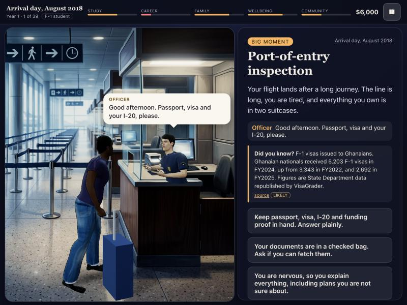

# Immigrant

**[Play it in your browser](https://complyrim.github.io/immigrant/)** (free, no install; works on phones too)

A narrative life-sim about moving to the United States. You choose where you come from, how you arrive and where you land, then live it one month at a time: three decisions a month, evenings in between, and consequences that carry from year to year.



- **30 home countries on 6 continents**, each with its own people, festivals and facts.
- **7 ways to arrive**: student (F-1), skilled worker (H-1B), extraordinary ability (O-1), family, visitor (B-2), asylum, and entry without inspection (shown only through its consequences).
- **Status that changes with your choices**: OPT, STEM OPT, H-1B, a return to school on F-1, adjustment of status, permanent residence and citizenship, or losing status and what follows.
- **Grounded in public data**: fees, wait times and visa figures come with their sources, shown in the game.
- **Painted 3D scenes**: hand-built MakeHuman characters in front of painted rooms that have real depth, speech bubbles with a transcript, generated music that changes from scene to scene, pause and resume, and an autosave so you can carry on later.

> This is a game, not legal advice. Immigration law is complex and changes often. Talk to an immigration attorney or an accredited representative about your own situation.

## Play

- **Online:** https://complyrim.github.io/immigrant/ (rebuilt automatically from `main` after every push that passes the checks).
- **Locally:**

```bash
npm ci
npm run dev
```

Then open http://127.0.0.1:5188. Press Esc or P to pause.

## Develop

| Command | What it does |
|---|---|
| `npm run dev` | Dev server with hot reload on port 5188 |
| `npm run build` | Type check and production build into `dist/` |
| `npm run preview` | Serve the production build on port 4188 |
| `npm test` | Browser smoke tests on desktop and phone viewports (needs a real graphics card, so run locally) |
| `npm run sim` | Whole-journey simulation of every route, no browser needed |

The simulation plays hundreds of journeys through the real rules and fails on errors, money statements that do not balance, or any card shown under a status it is not written for. GitHub runs the type check, the simulation and the production build on every push.

### Layout

| Path | Contents |
|---|---|
| `src/engine/` | Rules: routes, statuses, cards, odds, money, the year schedule |
| `src/engine/content/` | Cards and routes by theme (work, family, years ahead, status) |
| `src/world/` | Three.js scenes: painted stages with depth, the city, people and props |
| `src/ui/` | Screens, speech bubbles, pause and save |
| `src/audio/` | Generated music and per-scene ambience (no audio files) |
| `src/data/` | Countries, cities, eras, people and painting metadata |
| `research/` | Notes and sources behind the numbers and the law |
| `scripts/` | Asset pipelines: characters (Blender + MPFB2), depth maps, backdrops |

## Licences and contributing

- **Code:** [MIT](LICENSE).
- **Assets:** not all open licensed. The painted backdrops and voice lines are all rights reserved; see [ASSETS.md](ASSETS.md) before reusing any image, model or sound.
- **Contributions** are welcome under the [Contributor License Agreement](CLA.md). Read [CONTRIBUTING.md](CONTRIBUTING.md) first.

## Before a public release

- An immigration attorney reviews the legal mechanics (search the code for `attorney review`).
- Community readers review the tone of each country and route.
